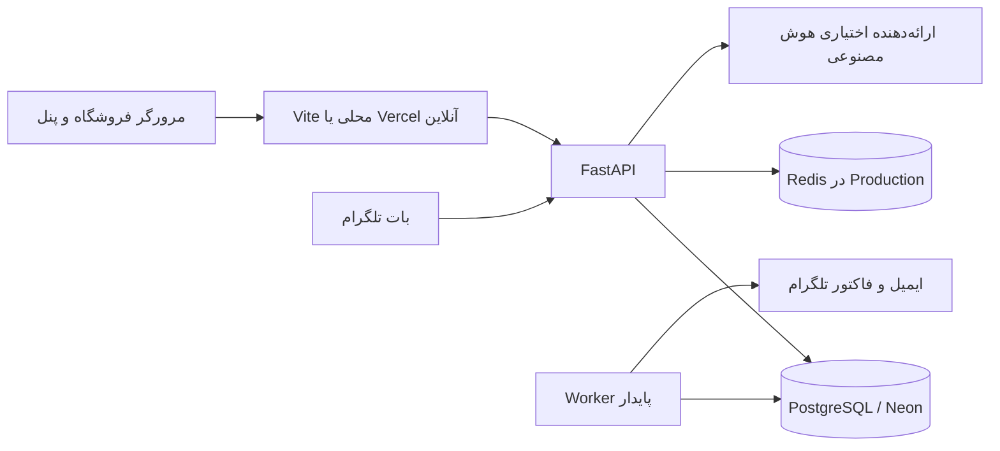

# فروشگاه دیجیتال نکسورا

**فارسی** · [English](README.md) · [راهنمای کامل اجرای محلی در ویندوز](docs/LOCAL_RUNBOOK.fa.md)

نکسورا یک فروشگاه تجهیزات دیجیتال با رابط فارسی و راست‌چین، پنل مدیریت واکنش‌گرا، بک‌اند Python و بات تلگرام برای خدمات مشتری و خرید عمده است. فروشگاه و پنل مدیریت از سامانهٔ حساب و نشست یکسان استفاده می‌کنند. درخواست عمده در تلگرام ثبت، در پنل بررسی و پس از تأیید، فاکتور آن برای همان مشتری ارسال می‌شود.

این راهنما امکانات موجود در کد را معرفی می‌کند؛ آماده‌بودن کد به‌تنهایی به معنی فعال‌بودن دیپلوی آنلاین، سرویس ایمیل، ارسال تلگرام یا درگاه پرداخت نیست.

## فهرست

- [امکانات فروشگاه](#storefront)
- [حساب، خرید و فاکتور](#accounts)
- [پنل مدیریت](#admin)
- [بات تلگرام](#telegram)
- [راهنمای هوشمند خرید](#assistant)
- [معماری و امنیت](#architecture)
- [ساختار مخزن](#structure)
- [اجرای محلی بدون Docker](#local)
- [تنظیمات و انتشار](#deployment)
- [تست‌ها](#testing)
- [محدودیت‌ها و مستندات تکمیلی](#limitations)

<a id="storefront"></a>
## امکانات فروشگاه

- رابط فارسی و RTL با فونت وزیرمتن، حالت روشن/تیره، طراحی مناسب موبایل و دسکتاپ، منوی تطبیقی و انیمیشن‌های نرم.
- هیرو، مجموعه‌های منتخب، محصولات پیشنهادی و داغ‌ترین‌ها، پیشنهادهای شگفت‌انگیز و مجلهٔ فناوری.
- ده گروه کاتالوگ: گوشی هوشمند، لپ‌تاپ و کامپیوتر، صوتی، گیمینگ، خانهٔ هوشمند، پوشیدنی‌ها، لوازم جانبی، دوربین و لنز، پهپاد و سایر تجهیزات.
- صفحات دسته‌بندی با جست‌وجو، فیلتر برند و موجودی، مرتب‌سازی، عکس محصول، مشخصات فنی و پنجرهٔ جزئیات سریع.
- یکسان‌سازی حروف و ارقام فارسی/عربی در جست‌وجوی محصولات.
- تصاویر محلی محصول و دسته، نسخه‌های بهینهٔ WebP، بارگذاری تنبل و پیش‌نمایش کم‌حجم پنل ادمین.
- کش کاتالوگ عمومی و نمایش دادهٔ قبلی هنگام تأخیر API؛ تازه‌سازی هنگام بازگشت کاربر. مسیر عکس‌های پیش‌فرض قدیمی شگفت‌انگیز از API یا کش، بدون تغییر عکس سفارشی مدیر، به عکس درست هدایت می‌شود.
- ساعت معکوس شگفت‌انگیز با ارقام فارسی و رعایت تنظیم کاهش حرکت. این ساعت تا نیمه‌شب محلی دستگاه بازدیدکننده است؛ زمان پایان یک کمپین تخفیف واقعی یا تغییر خودکار قیمت نیست.
- مقایسهٔ حداکثر سه محصول از یک دسته، افزودن/حذف/جایگزینی، ذخیرهٔ شناسه‌های انتخاب‌شده و نمایش فقط تفاوت‌ها. مقایسه برای مهمان هم فعال است.
- سبد خرید و علاقه‌مندی‌های متصل به حساب؛ قیمت و موجودی از API دریافت می‌شوند.
- مجلهٔ فناوری با صفحهٔ مقاله، اطلاعات متادیتا، تصاویر، منابع و محتوای مرتبط.
- مرکز پشتیبانی `/support`: ارسال و تحویل، آسیب‌دیدگی و مغایرت، درخواست بازگشت، گارانتی، پیگیری، FAQ متحرک، اطلاعات تماس تنظیم‌شده و معرفی بات عمده. لینک پشتیبانی هدر و فوتر به همین صفحه وصل است.
- صفحات خطای تصویردار و بازیابی خطای رندر با دکمه‌های بازگشت/تلاش مجدد.

<a id="accounts"></a>
## حساب کاربری، خرید و اسناد

- ثبت‌نام و ورود با ایمیل/رمز، ورود اختیاری گوگل، بازیابی رمز، تأیید/تغییر ایمیل، ویرایش پروفایل و خروج از نشست‌ها.
- داشبورد حساب با سفارش‌ها، جزئیات خرید، سبد، علاقه‌مندی‌ها و اتصال/قطع اتصال اختیاری تلگرام.
- فرم تحویل شامل گیرنده، تلفن، استان و شهر، کد پستی، نشانی و پلاک؛ واحد و توضیحات اختیاری. ارقام فارسی/عربی شماره‌ها یکسان‌سازی می‌شوند.
- ساخت پیش‌فاکتور، تازه‌سازی قیمت و تأیید بازبینی مبلغ؛ ثبت سفارش با کنترل قیمت و موجودی سمت سرور.
- رزرو موجودی در تراکنش؛ آزادسازی موجودی با انقضا یا لغو سفارش. تأیید پرداخت عملیات مجاز مدیر با مرجع پرداخت و کنترل تکرار است.
- ذخیرهٔ اطلاعات اقلام، قیمت، مشتری، نشانی و ضریب ریال در زمان سفارش؛ تغییر بعدی محصول یا پروفایل، سند ثبت‌شده را بازنویسی نمی‌کند.
- نمایش فاکتور برای مشتری/مدیر، HTML قابل دانلود و چاپ، PDF مستقیم مدیریتی با چیدمان راست‌چین و وزیرمتن و فرم کارت گارانتی قابل تکمیل توسط فروشنده.
- عضویت خبرنامه برای حساب واردشده، مدیریت اعضا و اعلان خوانده‌نشدهٔ مستقل برای هر مدیر.

<a id="admin"></a>
## پنل واحد مدیریت — `/admin`

| بخش | امکانات |
| --- | --- |
| داشبورد اصلی | آمار فروشگاه، مبلغ سفارش‌های پرداخت‌شده، شاخص موجودی، پوستر و آمار/نمودار درخواست‌های تلگرام |
| درخواست‌های تلگرام و عمده | ردیف خلاصه، جست‌وجو، فیلتر نوع/وضعیت، صفحه‌بندی، نام و تماس مشتری، اقلام، تعداد، نشانی، جزئیات و یادداشت داخلی |
| تأیید عمده | ورود اقلام و قیمت توافقی مدیر، بازبینی فاکتور، کد رهگیری هشت‌رقمی یکتا، PDF ذخیره‌شده، صف ارسال تلگرام، وضعیت تحویل و تلاش مجدد |
| سفارشات و فاکتورها | فهرست یکپارچهٔ سفارش سایت و عمدهٔ تأییدشده، فیلتر منبع، مشتری و اقلام، آدرس، دانلود فاکتور و عملیات مجاز لغو/تأیید دستی پرداخت سایت |
| محصولات و موجودی | ایجاد و ویرایش، توضیحات، مشخصات، تصویر، موجودی، جست‌وجو، فیلتر دسته و نوع، فعال/غیرفعال و بایگانی |
| بارگذاری تصویر | JPG/PNG/WebP اعتبارسنجی‌شده، محدودیت حجم/ابعاد، حذف metadata، ذخیرهٔ WebP در دیتابیس و ماندگاری پس از دیپلوی |
| ورود اکسل | قالب XLSX، اعتبارسنجی و پیش‌نمایش خطا، تأیید ورود و ایجاد محصولات بایگانی برای بررسی |
| تغییر گروهی قیمت | انتخاب دسته/برند، درصد افزایش، پیش‌نمایش و تأیید snapshot؛ فراتر از صفحهٔ فعلی محصولات |
| حساب‌های کاربران | جست‌وجو و مشاهدهٔ مشتری، لغو نشست مطابق مجوز |
| اعضای خبرنامه | جست‌وجو، حساب مرتبط، زمان عضویت، زنگولهٔ متحرک و شمارندهٔ خوانده‌شده/نشده برای هر مدیر |
| گزارش رویدادها | فیلتر نوع/تاریخ، صفحه‌بندی و خروجی Excel و Word با قالب XLSX/DOCX |
| محتوای صفحهٔ اصلی | هیرو، مجموعه‌ها و فهرست محصولات منتخب؛ کنترل تعارض نسخه در ذخیره |
| مجلهٔ فناوری | پیش‌نویس، انتشار، ویرایش مقاله، بخش‌ها، تصاویر و منابع |
| تنظیمات سیستم | نام و توضیحات فروشگاه، ایمیل و تلفن پشتیبانی |
| راهنمای هوشمند خرید | فعال/غیرفعال‌کردن، تنظیمات خوشامد/محدودیت و تست پاسخ مبتنی بر کاتالوگ |
| حساب و رابط مدیریت | تنظیمات حساب، تم روشن/تیره/سیستم، چشم رمز، بررسی اتصال، ناوبری واکنش‌گرا و طراحی شیشه‌ای ورود/داشبورد |

اپ مستقل Expo حذف شده و امکانات آمادهٔ آن در همین پنل جمع شده‌اند. نشانی قدیمی `/business` به `/admin` هدایت می‌شود. پنل از ریشهٔ پروژه همراه فروشگاه ساخته می‌شود و نصب مستقل اپ موبایل لازم نیست.

<a id="telegram"></a>
## بات تلگرام — [@NexoraShopHelperBot](https://t.me/NexoraShopHelperBot)

- تمرکز منوی فعلی: ثبت درخواست خرید عمده، پشتیبانی، سؤالات متداول، پیگیری و انتخاب زبان.
- رابط فارسی/انگلیسی، پیام خوشامد و دکمهٔ شروع، کیبورد ثابت پایین، اعتبارسنجی فرم، خلاصهٔ تأیید و امکان لغو.
- اطلاعات درخواست عمده: نام، تلفن، نام اختیاری شرکت/فروشگاه، کالا و تعداد، شهر، نشانی و توضیحات.
- ثبت در بک‌اند با کلید مشترک سرویس؛ پیام موفقیت فقط بعد از تأیید سرور. تأیید دوبارهٔ همان فرم شناسهٔ ثابت دارد تا درخواست تکراری ساخته نشود.
- بررسی در پنل، قیمت توافقی مدیر و تأیید فاکتور؛ ارسال کد رهگیری و همان PDF ذخیره‌شدهٔ مدیر به حساب تلگرامی ثبت‌کننده از طریق worker بک‌اند.
- پیگیری مختص همان کاربر و دریافت دوبارهٔ فاکتور؛ یادداشت داخلی مدیر به مشتری نمایش داده نمی‌شود.
- اتصال اختیاری حساب سایت با لینک یک‌بارمصرف؛ بات رمز سایت را درخواست نمی‌کند.
- مسیرهای قدیمی دسته‌بندی، محصول، تصویر دسته، جست‌وجو و مقایسهٔ هم‌دسته برای سازگاری باقی مانده‌اند؛ محور منوی جدید خدمات مشتری است.
- اجرای محلی polling با `main.py`، بررسی آماده‌بودن با `preflight.py`، ابزار اندازه‌گیری تأخیر و استقرار جداگانهٔ webhook با وضعیت ماندگار PostgreSQL.
- بات فعلی چتی است و مینی‌اپ تلگرام نیست. برای یک توکن فقط یک polling روشن باشد؛ polling با webhook هم‌زمان اجرا نمی‌شود.

<a id="assistant"></a>
## راهنمای هوشمند خرید

پیشنهاد محصول بر اساس بودجه/دسته و مقایسهٔ فنی با اتکا به کاتالوگ. قیمت، موجودی، مشخصات و شناسهٔ کالا از دیتابیس خوانده می‌شوند. ارائه‌دهندهٔ تنظیم‌شدهٔ DeepSeek، Gemini یا OpenAI می‌تواند طرح ساختاریافتهٔ پاسخ را بسازد؛ خطای سرویس به راهنمای پایهٔ کاتالوگ برمی‌گردد. کلید معتبر، مدل در دسترس، سهمیه و اعتبار سرویس، تنظیمات جداگانهٔ عملیاتی هستند.

<a id="architecture"></a>
## معماری، فناوری و سازوکارهای امنیتی



| بخش | فناوری |
| --- | --- |
| فروشگاه و پنل | React 19، JavaScript/TypeScript، Vite 8، Tailwind CSS 4، Motion، Lucide |
| بک‌اند | Python، FastAPI، Pydantic 2، SQLAlchemy 2، psycopg، Alembic |
| داده و محدودساز | PostgreSQL؛ Neon در میزبانی فعلی، Redis در Production |
| اسناد | openpyxl، ReportLab، Arabic reshaping/bidi و فونت وزیرمتن |
| بات | aiogram 3، HTTPX، FastAPI برای webhook و psycopg |
| هویت و ایمیل | Argon2، اعتبارسنجی گوگل و Resend |
| پیکربندی میزبانی | Vercel برای فرانت/پنل، Render برای API و میزبان جدا برای بات |

نسخهٔ پیشنهادی اجرای محلی: Node.js از 22.12 به بالا، Python 3.13 و PostgreSQL 17. محدودهٔ اعلام‌شدهٔ Python در پکیج‌های پروژه `>=3.12,<3.15` است؛ وابستگی‌ها با `uv.lock` تثبیت شده‌اند.

سازوکارهای پیاده‌سازی‌شده:

- تفکیک domain، کاربردها و portها، آداپتورهای infrastructure و routeهای presentation.
- اعتبارسنجی Pydantic، مبلغ Decimal، migration نسخه‌دار و seed تکرارپذیر با حفظ ویرایش مدیر.
- قفل ردیف و تغییر شرطی موجودی در PostgreSQL و آزادسازی رزرو منقضی‌شده با worker.
- هش Argon2 رمز، هش توکن نشست و عملیات، انقضا/ابطال، کوکی HttpOnly و CSRF وابسته به نشست.
- بررسی permission در API برای محصول، سفارش، کاربر، محتوا، گزارش و دستیار؛ مخفی‌کردن منو تنها کنترل دسترسی نیست.
- نقش محدود runtime و نقش جداگانهٔ migration؛ اعتبار برنامه اجازهٔ اعطای نقش مدیریت ندارد.
- Redis برای محدودیت نرخ مشترک Production؛ محدودساز حافظه‌ای برای development.
- صف پایدار PostgreSQL و worker با lease/retry برای ایمیل و فاکتور؛ payload ایمیل با کلید مشتق از `SECRET_KEY` رمزگذاری می‌شود.
- هدرهای امنیتی، CORS با مبدأ دقیق، پاسخ خصوصی بدون کش عمومی و لاگ با حذف اطلاعات حساس.

وجود این سازوکارها گواهی امنیت یا تأیید تنظیمات Production نیست.

<a id="structure"></a>
## ساختار مخزن

```text
src/                          فروشگاه، حساب، مقایسه، خرید و پشتیبانی
AdminPanel/                   رابط پنل واحد؛ ساخت از ریشه
public/assets/                تصاویر محلی و فایل‌های عمومی
backend/
  app/domain/                 موجودیت‌ها و قواعد کسب‌وکار
  app/application/            کاربردها و درگاه‌های مخزن داده
  app/infrastructure/         دیتابیس، رمز، ایمیل، PDF، هوش مصنوعی، worker
  app/presentation/           routeها و قراردادهای API
  app/core/                   تنظیمات و لاگ
  app/seed.py                 دادهٔ اولیه و اصلاح محدود عکس‌های قدیمی
  alembic/                    migrationها
  data/                       محصولات و محتوای پیش‌فرض
  scripts/                    ساخت نقش‌ها، grants و ممیزی
  tests/                      تست واحد، یکپارچه و امنیت
  start.py                    migration، seed، API و worker
  legacy/                     نسخهٔ آرشیوی ASP.NET؛ API فعال نیست
telegram_bot/                 کد و lock جداگانهٔ بات؛ polling/webhook
scripts/                      تست منطق فرانت، مرورگر و ابزار تصاویر
agents/                       نمونهٔ مستقل اختیاری دستیار؛ برای اجرا لازم نیست
.github/workflows/            بررسی‌های خودکار
vercel.json                   مسیرهای فرانت/پنل و پروکسی API
render.yaml                   پیکربندی استقرار بک‌اند
compose.yaml                  روش اختیاری کانتینر؛ الزامی نیست
docs/LOCAL_RUNBOOK.fa.md       دستورهای نگهداری‌شدنی اجرا و عیب‌یابی ویندوز
```

<a id="local"></a>
## اجرای محلی بدون Docker

برای نصب نخست، ساخت نقش دیتابیس، فایل‌های env و عیب‌یابی، [راهنمای کامل ویندوز](docs/LOCAL_RUNBOOK.fa.md) را بخوانید. پس از آماده‌سازی، سه ترمینال مستقل کافی است:

**۱ — بک‌اند**

```powershell
cd D:\nexoraShop\backend
$env:UV_PROJECT_ENVIRONMENT = ".venv-admin"
uv sync --frozen
uv run --frozen python start.py
```

**۲ — فرانت و پنل ادمین**

```powershell
cd D:\nexoraShop
npm ci --no-audit --no-fund
npm run dev
```

**۳ — بات تلگرام**

```powershell
cd D:\nexoraShop\telegram_bot
uv sync --frozen
uv run --frozen python preflight.py --customer-service
uv run --frozen python preflight.py --telegram
uv run --frozen python main.py
```

| مقصد | نشانی محلی |
| --- | --- |
| فروشگاه | http://localhost:3000 |
| ادمین | http://localhost:3000/admin |
| پشتیبانی | http://localhost:3000/support |
| سلامت بک‌اند | http://127.0.0.1:8000/health |
| مستندات API | http://127.0.0.1:8000/docs |

رمز پیش‌فرض ادمین وجود ندارد. ابزار `python -m app.setup_local_admin EMAIL` فقط برای ساخت/تنظیم مدیر development با دیتابیس localhost است؛ حساب آنلاین در دیتابیس آنلاین مستقل است.

<a id="deployment"></a>
## تنظیمات و انتشار

| محل | تنظیمات مهم |
| --- | --- |
| `backend/.env` | `DATABASE_URL`، `MIGRATION_DATABASE_URL`، `SECRET_KEY` پایدار، `ENVIRONMENT`، `FRONTEND_URL`، `MIGRATE_ON_START` و `RUN_WORKER` |
| بک‌اند Production | `REDIS_URL` و تنظیمات سرویس ایمیل برای تأیید/بازیابی |
| ارائه‌دهندهٔ اختیاری | `GOOGLE_CLIENT_ID`؛ `ASSISTANT_PROVIDER`، کلید مربوط و مدل |
| تلگرام در بک‌اند | `TELEGRAM_BOT_API_KEY`، `TELEGRAM_BOT_USERNAME` و `TELEGRAM_BOT_TOKEN` برای ارسال فاکتور |
| `telegram_bot/.env` | `BOT_TOKEN`، آدرس مستقیم بک‌اند در `NEXORA_API_URL`، کلید مشترک یکسان، `FRONTEND_URL` و `PROXY_URL` اختیاری |
| میزبان webhook بات | `WEBHOOK_SECRET` و `BOT_DATABASE_URL` محدود؛ اعتبار migration فقط برای آماده‌سازی |
| پروکسی Vite محلی | متغیر شل اختیاری `API_PROXY_TARGET`؛ پیش‌فرض `http://127.0.0.1:8000` |

`BOT_TOKEN` بات و `TELEGRAM_BOT_TOKEN` بک‌اند همان توکن BotFather هستند. `TELEGRAM_BOT_API_KEY` کلید متفاوت مشترک حداقل ۳۲ کاراکتری است. هیچ رمز، URL دارای پسورد، توکن یا فایل env واقعی نباید وارد گیت یا متغیر عمومی فرانت شود.

نشانی‌های عمومی پیکربندی‌شده:

- فروشگاه و پنل: https://nexora-digital-shop.vercel.app و مسیر `/admin`.
- API: https://nexora-api-s2q3.onrender.com.
- بات: https://t.me/NexoraShopHelperBot.

Vercel: ریشهٔ مخزن، فرمان `npm run build:vercel` و خروجی `dist`. فایل `vercel.json` ابتدا `/api/*` را به Render می‌فرستد و سپس پنل/SPA را مسیریابی می‌کند. متغیر `NEXORA_API_ORIGIN` در این JSON جایگزین نمی‌شود؛ تغییر میزبان نیازمند اصلاح rewrite و دیپلوی مجدد است. درخواست مرورگر باید هم‌مبدأ بماند.

Blueprint رندر از Dockerfile بک‌اند استفاده می‌کند؛ این موضوع Docker را برای اجرای لوکال الزامی نمی‌کند. در Production نقش محدود دیتابیس، migration، Redis، HTTPS، secret پایدار و تنظیمات سرویس‌های لازم باید آماده باشند. تغییر `.env` لپ‌تاپ تنظیمات Render را تغییر نمی‌دهد.

برای ورود آنلاین، حساب باید در دیتابیس آنلاین موجود و دارای مجوز مدیریت باشد. نام کاربری/رمز مشترک پیش‌فرض نداریم و حساب لوکال خودکار به Neon منتقل نمی‌شود. [چک‌لیست ورود آنلاین](docs/LOCAL_RUNBOOK.fa.md#online-admin).

بات میزبان جدا می‌خواهد. فرانت استاتیک polling اجرا نمی‌کند؛ نسخهٔ webhook به سرویس، دیتابیس وضعیت، secret و ثبت آدرس در تلگرام نیاز دارد. [راهنمای webhook](telegram_bot/DEPLOYMENT.fa.md).

<a id="testing"></a>
## تست و اعتبارسنجی

```powershell
# ریشهٔ پروژه
npm run lint
npm run build:vercel
node --test scripts/*.test.mjs

# پوشهٔ backend
uv run --frozen python -m pytest -q
uv run --frozen ruff check app tests alembic scripts start.py
uv run --frozen python scripts/audit_dependencies.py

# پوشهٔ telegram_bot
uv run --frozen python -m pytest -q
uv run --frozen python preflight.py --customer-service
uv run --frozen python preflight.py --telegram
```

تست سریع بک‌اند SQLite موقت را فقط به‌عنوان test double استفاده می‌کند. آزمون رقابت PostgreSQL به `TEST_DATABASE_URL` و آزمون Redis به `TEST_REDIS_URL` اختصاصی تست نیاز دارد؛ URL دیتابیس Production ندهید، چون schemaهای تست ساخته و حذف می‌شوند.

هر اسکریپت مرورگر `scripts/check-*.mjs` سرور/fixture خودش را می‌خواهد؛ فایل آن و [یادداشت اعتبارسنجی پنل](AdminPanel/VALIDATION.md) را بخوانید. موفقیت تست شبیه‌سازی‌شده، ورود زندهٔ ادمین، ارسال ایمیل/تلگرام یا پردازش پرداخت را تأیید نمی‌کند.

<a id="limitations"></a>
## محدودیت‌ها و مرز امکانات

- بخشی از قیمت/پیکربندی seed نمونه است؛ ضریب فعلی نمایش ۶۰۰٬۰۰۰ ریال برای هر واحد پایه، نرخ زندهٔ ارز نیست. سفارش‌ها snapshot نرخ خود را دارند. قیمت و موجودی واقعی نیازمند نگهداری‌اند.
- ساعت روزانهٔ پیشنهادها، پایان تخفیف یا تغییر قیمت ایجاد نمی‌کند.
- تأیید پرداخت دستی و مجوزدار است؛ درگاه بانکی و تطبیق خودکار تراکنش نداریم.
- عمدهٔ تأییدشده، سفارش پرداخت‌شده یا رزرو موجودی سایت نمی‌سازد؛ در دفتر یکپارچه با منبع جدا دیده می‌شود.
- PDF عمدهٔ صادرشده ثابت است؛ تغییر قالب روی فاکتور جدید اثر دارد. retry پس از قطع مبهم شبکه ممکن است همان پیام تلگرام را تکرار کند؛ کد و سند عوض نمی‌شوند.
- کارت گارانتی به سریال، شرایط و مهر واقعی فروشنده نیاز دارد؛ مدیریت دیجیتال گارانتی یا صورتحساب رسمی مالیاتی نیست.
- خبرنامه ثبت عضویت و اعلان پنل دارد؛ ارسال کمپین تبلیغاتی یا push موبایل پیاده نشده است.
- پلن رایگان Render/Neon ممکن است بخوابد؛ سرعت و سهمیه و مجازبودن استفادهٔ تجاری تابع سرویس و پلن جاری است.
- اپ مستقل Expo حذف شده، ASP.NET آرشیوی است و نمونهٔ `agents/` برای اجرا لازم نیست. مینی‌اپ تلگرام هنوز پیاده نشده است.
- داده‌ها، هش رمز و کوکی‌های ASP.NET قدیمی خودکار وارد بک‌اند Python نمی‌شوند.

## مستندات تکمیلی

| موضوع | راهنما |
| --- | --- |
| اجرای کامل ویندوز و عیب‌یابی | [docs/LOCAL_RUNBOOK.fa.md](docs/LOCAL_RUNBOOK.fa.md) |
| نصب نخست PostgreSQL | [backend/LOCAL_SETUP.fa.md](backend/LOCAL_SETUP.fa.md) |
| مجوزها و راه‌اندازی ادمین | [backend/ADMIN_PANEL.fa.md](backend/ADMIN_PANEL.fa.md) |
| امکانات پنل واحد | [AdminPanel/MIGRATION.fa.md](AdminPanel/MIGRATION.fa.md) |
| اعتبارسنجی پنل | [AdminPanel/VALIDATION.md](AdminPanel/VALIDATION.md) |
| استقرار | [backend/DEPLOYMENT.fa.md](backend/DEPLOYMENT.fa.md) |
| معماری و امنیت | [backend/SECURITY_ARCHITECTURE.fa.md](backend/SECURITY_ARCHITECTURE.fa.md) |
| کاتالوگ و کارایی | [backend/CATALOG.fa.md](backend/CATALOG.fa.md)، [backend/CATALOG_PERFORMANCE.fa.md](backend/CATALOG_PERFORMANCE.fa.md) |
| افزایش گروهی قیمت و اکسل | [backend/BULK_PRICING.fa.md](backend/BULK_PRICING.fa.md)، [backend/PRODUCT_IMPORT.fa.md](backend/PRODUCT_IMPORT.fa.md) |
| خرید و فاکتور | [backend/INVOICES.fa.md](backend/INVOICES.fa.md)؛ شرح تاریخی HTML است و پنل فعلی PDF مستقیم هم دارد |
| راهنمای هوشمند | [backend/ASSISTANT.fa.md](backend/ASSISTANT.fa.md) |
| بات و خدمات مشتری | [telegram_bot/README.md](telegram_bot/README.md)، [telegram_bot/CUSTOMER_CARE.fa.md](telegram_bot/CUSTOMER_CARE.fa.md) |
| میزبانی webhook | [telegram_bot/DEPLOYMENT.fa.md](telegram_bot/DEPLOYMENT.fa.md) |

بعضی راهنماهای قدیمی جزئیات مراحل قبلی توسعه را دارند. برای اجرای فعلی پنل واحد، این README و راهنمای ذخیره‌شدهٔ اجرای محلی را مبنا قرار دهید و هنگام استقرار، کد و تنظیمات جاری را بررسی کنید.
