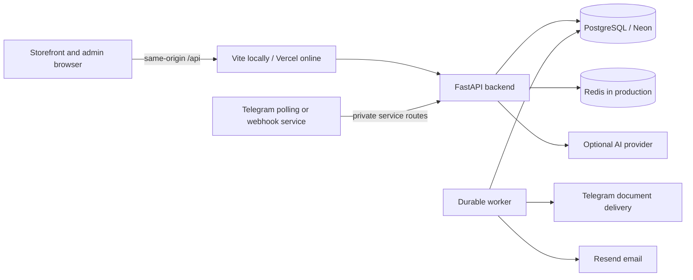

# Nexora Digital Shop

[فارسی](README.fa.md) · **English** · [Windows local runbook / راهنمای اجرای محلی](docs/LOCAL_RUNBOOK.fa.md)

Nexora is a Persian, right-to-left electronics storefront with a responsive management panel, a Python API, and a Telegram customer-service and wholesale bot. The storefront and admin panel share the same account/session system; wholesale enquiries are reviewed in the admin panel and approved invoices can be delivered back to the customer through Telegram.

This README describes the implemented code. It does not certify that an external deployment, payment provider, email provider, or Telegram delivery is currently operational.

## Contents

- [Features](#features)
- [Architecture and technology](#architecture-and-technology)
- [Repository structure](#repository-structure)
- [Run locally without Docker](#run-locally-without-docker)
- [Configuration](#configuration)
- [Deployment and admin access](#deployment-and-admin-access)
- [Checks and testing](#checks-and-testing)
- [Scope and limitations](#scope-and-limitations)
- [Further documentation](#further-documentation)

## Features

### Storefront and catalogue

- Responsive Persian/RTL layout, Vazirmatn typography, light/dark themes, animated sections, mobile navigation, and desktop navigation.
- Home hero, featured collections, trending/recommended products, amazing deals, and technology articles.
- Ten catalogue groups: smartphones, laptops/computers, audio, gaming, smart home, wearables, accessories, cameras/lenses, drones, and other equipment.
- Category pages with product search, brand filtering, availability filtering, sorting, product images, technical specifications, and quick-view details.
- Persian/Arabic character and numeral normalization for catalogue search.
- Locally hosted product/category images, optimized WebP assets, lazy loading, and compact admin thumbnails.
- Public catalogue caching, stale-data fallback, refresh on return, and explicit replacement of retired deal-image placeholders from older API responses/browser caches. Custom merchant images are preserved.
- Amazing-deals clock with Persian digits and reduced-motion support. It counts down to the visitor's local midnight; it is **not** a configured campaign expiry or an automatic price change.
- Guest product comparison: up to three products in one category, add/remove/replace, persistent selected IDs, and a differences-only view.
- Cart and wishlist integrated with the authenticated account; current prices and availability come from the API.
- Technology magazine with article pages, editorial metadata, images, sources, and related content.
- `/support`: shipping/delivery, damaged or mismatched goods, return requests, warranty guidance, order tracking, animated FAQ, configured contact details, and wholesale bot links in the header/footer.
- Illustrated not-found/error screens and a render-error boundary with recovery actions.

### Accounts, checkout, orders, and documents

- Email/password registration and login, optional Google sign-in, password recovery, email verification/change, profile updates, and logout/all-session revocation.
- Account dashboard for profile, wishlist, cart, order history/details, and optional Telegram account linking/unlinking.
- Checkout collects recipient, phone, province/city, postal code, address, building, and optional unit/notes; Persian and Arabic digits are normalized.
- Draft invoice, price revision/refresh, and order submission with server-side price/stock validation and transactional inventory reservations.
- Reservation expiry and cancellation release stock; operator payment confirmation uses a permission-protected, idempotent management operation.
- Stored order snapshots retain customer/address, item prices, and the conversion rate used at order time.
- Customer/admin invoice views, downloadable/printable HTML, server-generated admin PDF, and a seller-completed warranty-card form. PDF rendering uses Vazirmatn and RTL layout.
- Newsletter registration tied to the signed-in account; membership management and per-admin unread notifications.

### Unified administration — `/admin`

| Area | Implemented capabilities |
| --- | --- |
| Dashboard | Store metrics, paid-order totals, inventory indicators, dashboard poster, and Telegram enquiry statistics |
| Telegram / wholesale enquiries | Compact searchable/paginated rows, type/status filters, customer/contact/address/items, detail view, internal notes, and status management |
| Wholesale approval | Admin-entered agreed items/prices, invoice preview, unique eight-digit tracking code, saved PDF, queued Telegram delivery, delivery state, and retry |
| Orders and invoices | Unified website/approved-Telegram register, source filter, customer and item details, shipping address, invoice downloads, site-order cancellation/manual payment confirmation where permitted |
| Products and stock | Create/edit, description/specifications, category/type filters, search, images, inventory, activate/deactivate, and archive |
| Product images | Validated JPG/PNG/WebP upload, metadata removal, size/dimension limits, and database-backed WebP media that survives redeploys |
| Excel import | XLSX template, validation/preview, error reporting, confirmed import, and archived imported products for review |
| Bulk pricing | Category/brand selection, percentage increase, preview, and snapshot confirmation; not restricted to the current product page |
| Customers | Account search/details and permission-protected session revocation |
| Newsletter | Subscriber search, account association, signup time, animated bell, and per-admin unread/read state |
| Audit events | Event/date filters, pagination, and downloadable XLSX/DOCX reports |
| Home content | Hero, featured collections, and selected product lists with optimistic version checks |
| Magazine | Draft/publish/edit articles, structured sections, images, and sources |
| Settings | Store name/description and contact details |
| Shopping assistant | Enable/disable, welcome/configuration controls, request limits, and response testing against the catalogue |
| Admin account / shell | Account controls, light/dark/system theme, password visibility toggle, connection check, responsive navigation, and glass-style login/dashboard design |

The separate Expo app has been retired. Its implemented capabilities are consolidated in this panel; `/business` redirects to `/admin`. The panel is built from the repository root, not as a separate mobile application.

### Telegram — [@NexoraShopHelperBot](https://t.me/NexoraShopHelperBot)

- Main workflow: wholesale enquiry, support request, FAQ, request tracking, and language selection.
- Persian/English chat UI, welcome/start action, persistent bottom keyboard, input validation, confirmation summary, and cancel flow.
- Wholesale form collects name, phone, optional business, requested products/quantities, city, address, and notes.
- Requests are saved through authenticated backend service routes; success is announced only after server confirmation. Retrying the same submission uses a stable request identifier.
- Admin reviews the request, sets agreed prices, and approves the invoice. The customer receives the tracking code and the **same saved PDF** available to the admin, via the backend's durable delivery worker.
- Customer-specific tracking and invoice re-download; private admin notes are not exposed to customers.
- Optional single-use website account linking; the bot never asks for a website password.
- Legacy category/product browsing, search, same-category comparison, and category images remain available for compatibility; customer care is now the main menu's focus.
- Local polling (`main.py`), read-only preflight checks, latency benchmark, and a separate webhook deployment with PostgreSQL-backed bot state.
- The chat bot is not a Telegram Mini App. Polling requires a running process; only one poller should use a token, and it must not compete with a webhook.

### Shopping assistant

Catalogue-grounded product recommendations, budget/category clarification, and technical comparisons. Prices, stock, specifications, and product IDs come from the catalogue; a configured DeepSeek, Gemini, or OpenAI provider can produce the structured recommendation plan. Provider failure falls back to the base catalogue guide, rather than inventing inventory. Provider credentials, model availability, quota, and billing are separate operational requirements.

### Backend and security mechanisms

- Layered FastAPI application: domain rules, application use cases/ports, infrastructure adapters, presentation routes, and a composition root.
- Pydantic validation, SQLAlchemy/Decimal monetary calculations, Alembic schema migrations, and idempotent seeding that preserves merchant edits.
- PostgreSQL row locks and conditional updates protect stock/reservations; the worker releases expired reservations.
- Argon2 password hashes, hashed random session/action tokens, expiry/revocation, HttpOnly session cookies, and session-bound CSRF tokens.
- Permission checks in the API for administrative operations, including separate product, order, user, audit, content, and assistant permissions.
- Separate restricted runtime and migration database roles. The runtime credential cannot assign administrative roles.
- Redis-backed shared rate limits in production; local development can use an in-memory limiter.
- Durable PostgreSQL outbox/leased worker for email and wholesale document delivery, with retry states; email delivery payloads are encrypted using a key derived from `SECRET_KEY`.
- Security headers, configurable exact CORS origins, private/no-store protected responses, request validation, and redacted logging.

These are implementation mechanisms, not a security certification or a guarantee of an unreviewed production configuration.

## Architecture and technology



| Component | Technology |
| --- | --- |
| Storefront / admin | React 19, JavaScript/TypeScript, Vite 8, Tailwind CSS 4, Motion, Lucide |
| API | Python, FastAPI, Pydantic 2, SQLAlchemy 2, psycopg, Alembic |
| Persistence | PostgreSQL; Neon is the configured hosted database option |
| Rate limits | Redis in production |
| Documents | openpyxl, ReportLab, Arabic reshaping/bidi, embedded Vazirmatn |
| Bot | aiogram 3, HTTPX, optional FastAPI webhook, psycopg |
| Authentication / email | pwdlib/Argon2, Google authentication verification, Resend |
| Hosting configuration | Vercel storefront/admin proxy, Render API, optional separate bot host |

Use Node.js 22.12+ and Python 3.13 for the documented local setup. Python packages currently declare `>=3.12,<3.15`; use the committed `uv.lock` files. PostgreSQL 17 matches the repository's local/CI setup.

## Repository structure

```text
src/                          Storefront, account, comparison, checkout, support
AdminPanel/                   Unified admin UI, built with the root Vite application
public/assets/                Local product/category/editorial/admin assets
backend/
  app/domain/                 Entities and business invariants
  app/application/            Use cases and repository ports
  app/infrastructure/         Database, crypto, email, PDF, AI, workers
  app/presentation/           FastAPI routers and request/response schemas
  app/core/                   Configuration and logging
  app/seed.py                 Idempotent initial data / legacy image upgrades
  alembic/                    Schema migrations
  data/                       Initial products, catalogue and site content
  scripts/                    Database role setup, grants and audits
  tests/                      Unit, integration and security tests
  start.py                    Migration, seeding, API and worker supervision
  legacy/                     Archived ASP.NET implementation; not the active API
telegram_bot/                 Bot code, separate uv lock, polling/webhook tools
scripts/                      Frontend logic tests, browser checks, asset tools
agents/                       Optional separate assistant prototype; not required to run the store
.github/workflows/            Automated checks
vercel.json                   Storefront/admin routing, API proxy, headers
render.yaml                   Backend deployment blueprint
compose.yaml                  Optional container setup; not required locally
docs/LOCAL_RUNBOOK.fa.md       Saved Windows start/stop/troubleshooting guide
```

## Run locally without Docker

Follow [the complete Windows runbook](docs/LOCAL_RUNBOOK.fa.md) for first-time PostgreSQL roles, safe `.env` setup, admin provisioning, proxies, checks, and troubleshooting. Once installed and configured, use three terminals:

**1 — Backend**

```powershell
cd D:\nexoraShop\backend
$env:UV_PROJECT_ENVIRONMENT = ".venv-admin"
uv sync --frozen
uv run --frozen python start.py
```

**2 — Storefront and admin**

```powershell
cd D:\nexoraShop
npm ci --no-audit --no-fund
npm run dev
```

**3 — Telegram**

```powershell
cd D:\nexoraShop\telegram_bot
uv sync --frozen
uv run --frozen python preflight.py --customer-service
uv run --frozen python preflight.py --telegram
uv run --frozen python main.py
```

| Destination | Local address |
| --- | --- |
| Store | http://localhost:3000 |
| Admin | http://localhost:3000/admin |
| Support | http://localhost:3000/support |
| Backend health | http://127.0.0.1:8000/health |
| Interactive API docs | http://127.0.0.1:8000/docs |

There are **no default admin passwords**. An operator can create/reset a development-only localhost admin with `python -m app.setup_local_admin EMAIL`; online roles/passwords belong to the online database and are configured separately.

## Configuration

Never commit real `.env` files, BotFather tokens, database URLs containing passwords, session secrets, or provider keys. Public frontend variables cannot safely hold private credentials.

| Location | Important values |
| --- | --- |
| `backend/.env` | `DATABASE_URL`, `MIGRATION_DATABASE_URL`, stable `SECRET_KEY`, `ENVIRONMENT`, `FRONTEND_URL`, `MIGRATE_ON_START`, `RUN_WORKER` |
| Backend production | `REDIS_URL`; mail provider settings when email verification/recovery is used |
| Optional backend providers | `GOOGLE_CLIENT_ID`; `ASSISTANT_PROVIDER`, corresponding provider key and model |
| Backend Telegram integration | `TELEGRAM_BOT_API_KEY`, `TELEGRAM_BOT_USERNAME`, `TELEGRAM_BOT_TOKEN` for invoice delivery |
| `telegram_bot/.env` | `BOT_TOKEN`, direct backend `NEXORA_API_URL`, identical `TELEGRAM_BOT_API_KEY`, `FRONTEND_URL`, optional `PROXY_URL` |
| Bot webhook deployment | `WEBHOOK_SECRET`, restricted `BOT_DATABASE_URL`; migration credentials are setup-only |
| Local Vite proxy | Optional shell variable `API_PROXY_TARGET`; defaults to `http://127.0.0.1:8000` |

`BOT_TOKEN` in the bot and `TELEGRAM_BOT_TOKEN` in the backend represent the same BotFather token. `TELEGRAM_BOT_API_KEY` is a **different**, shared service credential of at least 32 characters. See the runbook for the exact file locations and a local Hiddify example.

## Deployment and admin access

Current configured public destinations:

- Storefront/admin: https://nexora-digital-shop.vercel.app and `/admin`.
- API: https://nexora-api-s2q3.onrender.com.
- Public bot: https://t.me/NexoraShopHelperBot.

On Vercel, use repository root, build command `npm run build:vercel`, and output `dist`. `vercel.json` proxies `/api/*` to Render before admin/SPA rewrites; `NEXORA_API_ORIGIN` is not interpolated by that JSON configuration. Changing hosts requires updating the rewrite and redeploying. Browser requests should remain same-origin.

The Render blueprint uses the backend Dockerfile, but local development does not need Docker. `start.py` applies migrations/seeding when enabled and supervises the API and worker. Production requires the restricted database role, migration configuration, Redis, stable secrets, HTTPS and the required provider settings. Changing local `.env` does not change Render.

An online admin must be an account in the **online database**, with management permissions assigned by an operator. There is no dedicated universal admin password and no automatic local-to-Neon account synchronization. [Online login checks and operator instructions](docs/LOCAL_RUNBOOK.fa.md#online-admin).

The bot is a separate deployment. Static frontend hosting does not run polling; the webhook deployment needs its own service, persistent state, secret and Telegram registration. [Webhook deployment](telegram_bot/DEPLOYMENT.fa.md).

## Checks and testing

```powershell
# Repository root
npm run lint
npm run build:vercel
node --test scripts/*.test.mjs

# backend directory
uv run --frozen python -m pytest -q
uv run --frozen ruff check app tests alembic scripts start.py
uv run --frozen python scripts/audit_dependencies.py

# telegram_bot directory
uv run --frozen python -m pytest -q
uv run --frozen python preflight.py --customer-service
uv run --frozen python preflight.py --telegram
```

Backend quick tests use temporary SQLite databases as test doubles. PostgreSQL concurrency tests need a dedicated `TEST_DATABASE_URL`; Redis tests need a dedicated `TEST_REDIS_URL`. Never point tests at production. Test schemas are created and dropped.

Browser scripts under `scripts/check-*.mjs` have individual server/fixture requirements; see their source and [admin validation notes](AdminPanel/VALIDATION.md). Mocked browser checks do not establish successful live login, payment processing, email delivery or Telegram delivery.

## Scope and limitations

- Catalogue seed prices/configurations include demo values. The fixed display conversion of 600,000 rials per base unit is not a live exchange rate; saved orders keep their rate snapshot. Actual vendor prices/stock need operational maintenance.
- The daily deals timer does not end a discount or change product prices.
- Payment confirmation is manual/permission-protected; there is no integrated bank gateway/reconciliation.
- Wholesale enquiries and their approval are not automatically paid website orders and do not reserve website stock. The unified register shows them as a separate source.
- Saved wholesale PDFs are immutable; a template update affects new invoices. Retry after an ambiguous network failure can duplicate a delivered Telegram message, but not the invoice/tracking code.
- Warranty documents need the seller's actual serials, terms and stamp. They are not an electronic warranty-management system or a certified tax invoice.
- Newsletter membership/notifications do not implement a marketing campaign sender or mobile push service.
- Free Render/Neon plans may sleep; response times, availability and current service limits depend on the host. Review the hosting plan's commercial-use terms.
- The former Expo app, archived ASP.NET code and optional assistant prototype are not required runtime services. A Telegram Mini App is not implemented.
- Existing legacy ASP.NET data/hashes/cookies are not automatically migrated into the current Python backend.

## Further documentation

| Topic | Guide |
| --- | --- |
| Full Windows runbook | [docs/LOCAL_RUNBOOK.fa.md](docs/LOCAL_RUNBOOK.fa.md) |
| PostgreSQL first setup | [backend/LOCAL_SETUP.fa.md](backend/LOCAL_SETUP.fa.md) |
| Admin setup / permissions | [backend/ADMIN_PANEL.fa.md](backend/ADMIN_PANEL.fa.md) |
| Consolidated admin features | [AdminPanel/MIGRATION.fa.md](AdminPanel/MIGRATION.fa.md) |
| Admin validation | [AdminPanel/VALIDATION.md](AdminPanel/VALIDATION.md) |
| Hosting | [backend/DEPLOYMENT.fa.md](backend/DEPLOYMENT.fa.md) |
| Architecture / security | [backend/SECURITY_ARCHITECTURE.fa.md](backend/SECURITY_ARCHITECTURE.fa.md) |
| Catalogue / performance | [backend/CATALOG.fa.md](backend/CATALOG.fa.md), [backend/CATALOG_PERFORMANCE.fa.md](backend/CATALOG_PERFORMANCE.fa.md) |
| Bulk pricing / Excel import | [backend/BULK_PRICING.fa.md](backend/BULK_PRICING.fa.md), [backend/PRODUCT_IMPORT.fa.md](backend/PRODUCT_IMPORT.fa.md) |
| Checkout / invoices | [backend/INVOICES.fa.md](backend/INVOICES.fa.md) — historical HTML flow; current admin also supports direct PDF |
| AI assistant | [backend/ASSISTANT.fa.md](backend/ASSISTANT.fa.md) |
| Telegram setup / customer care | [telegram_bot/README.md](telegram_bot/README.md), [telegram_bot/CUSTOMER_CARE.fa.md](telegram_bot/CUSTOMER_CARE.fa.md) |
| Bot webhook hosting | [telegram_bot/DEPLOYMENT.fa.md](telegram_bot/DEPLOYMENT.fa.md) |

Some older component guides describe earlier milestones. Use this README and the saved runbook for the current unified-panel startup flow, and inspect the current code/configuration when deploying.
